# India Air Quality Warehouse

A daily ELT pipeline for hourly air quality and weather in 15 Indian cities, August 2022 to today:
Open-Meteo APIs → BigQuery → dbt (models and tests) → a static dashboard. GitHub Actions runs it every morning;
an Airflow DAG handles backfills.

- Dashboard: [neilss170.github.io/india-air-quality](https://neilss170.github.io/india-air-quality/)
- Guided tour of the dashboard: [neilss170.github.io/india-air-quality/?tour](https://neilss170.github.io/india-air-quality/?tour)
- dbt docs and lineage: [neilss170.github.io/india-air-quality/dbt](https://neilss170.github.io/india-air-quality/dbt/)

Every number in this README comes from a measured run; the reports are in [`reports/`](reports/).

## Tour

The live page has a guided tour (**Take the tour** in the header, or open it with
[`?tour`](https://neilss170.github.io/india-air-quality/?tour)): 12 steps that spotlight each part of the page and
explain what it shows. Arrow keys move between steps and Esc closes it; the page stays usable during the tour.

The page has three tabs, each with its own link:

- **Overview** (below): the charts across all 15 cities.
- **[City](https://neilss170.github.io/india-air-quality/?tab=city&city=Delhi)**: one city's latest complete day
  next to the other 14, a calendar of every day's PM index since August 2022, and its 10 worst days with the weather.
- **[Pipeline](https://neilss170.github.io/india-air-quality/?tab=pipeline)**: the run that built the page (rows
  loaded, source freshness, dbt results with any warnings, slowest models), the recent runs of the daily workflow
  from the GitHub API, and BigQuery table metadata including the sandbox expiry dates.

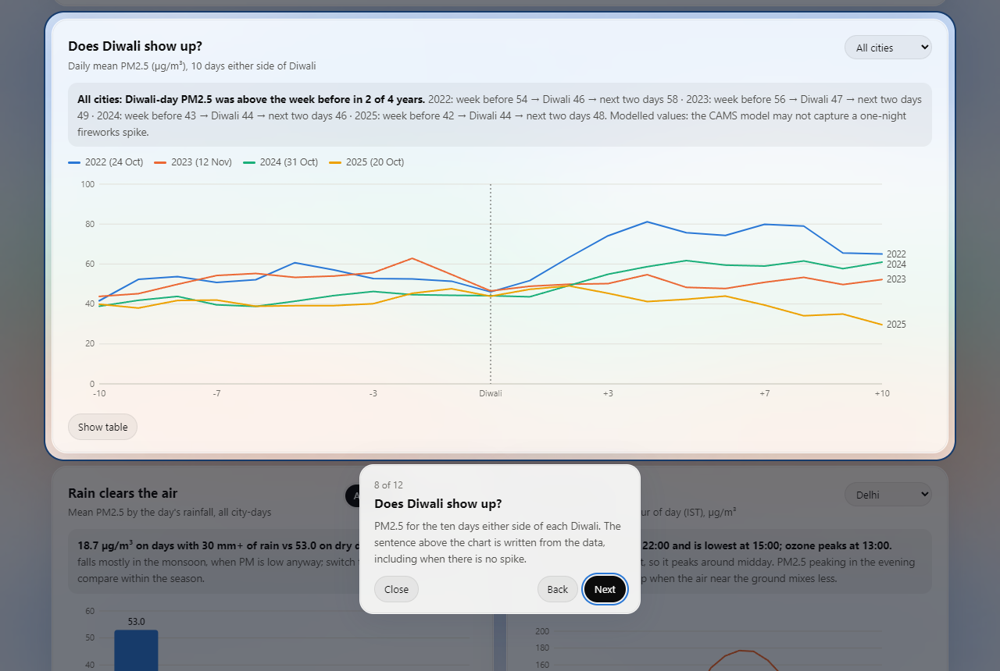

**1. Overview.** Freshness of the newest hour, headline numbers, and the two indices: the full CPCB AQI and the
PM index the dashboard leads with. Cities are ranked by mean index; the category mix shows how often each city's air
is Good through Severe. The sun/moon switch in the corner changes the theme; the background is slow waves of colour.

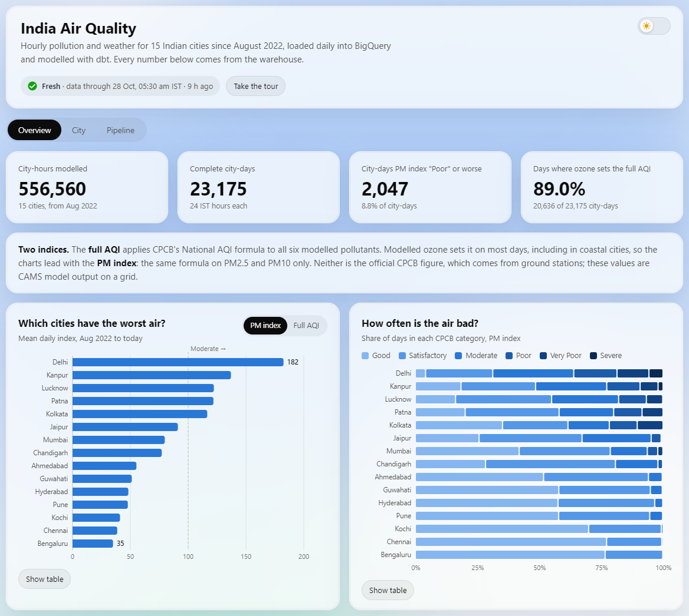

**2. Over time, and Diwali (dark theme).** Monthly index for any city against the 15-city mean, with the two CAMS
model upgrades marked, and PM2.5 for the ten days either side of each Diwali in the data. The finding above the chart is generated from the data: Diwali-day
PM2.5 was above the week before in 2 of 4 years.

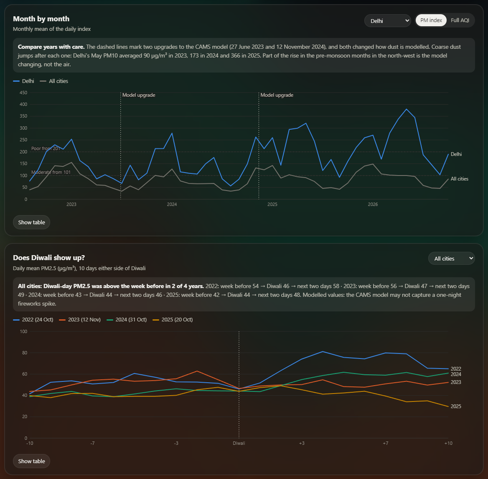

**3. Rain and the daily cycle.** Mean PM2.5 by the day's rainfall (switchable to monsoon days only), and the
average hour-by-hour profile of PM2.5 and ozone for any city.

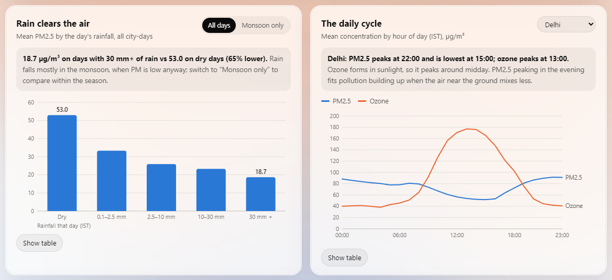

**4. Seasons.** Mean PM index by calendar month for every city. Every chart has hover tooltips and a table view.

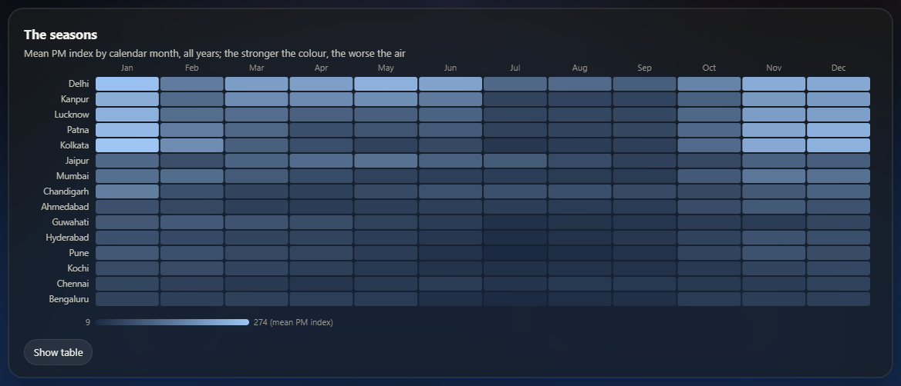

**5. City tab.** Delhi's latest complete day next to the other 14 cities (click a bar to switch city), and every
day since August 2022 coloured by CPCB category. Below it, not shown: the city's 10 worst days with the weather.

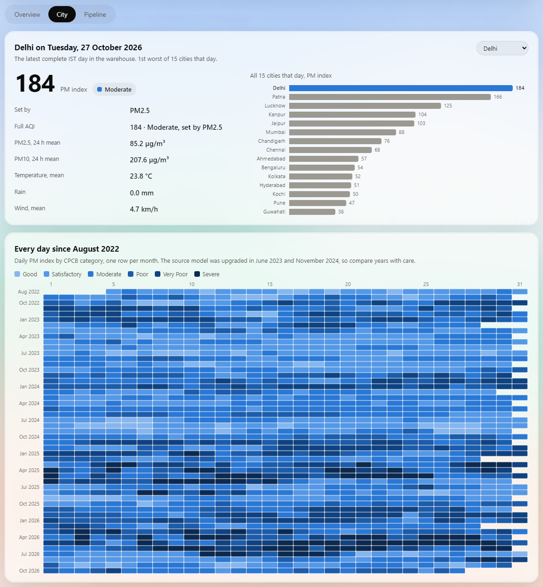

**6. Pipeline tab (dark theme).** Numbers from the run that built the page: rows loaded, source freshness, the dbt
build with its two known warnings, the slowest models, recent runs from the GitHub API and BigQuery table metadata.
When this was taken, all 10 runs had been started by hand, and the tab says so.

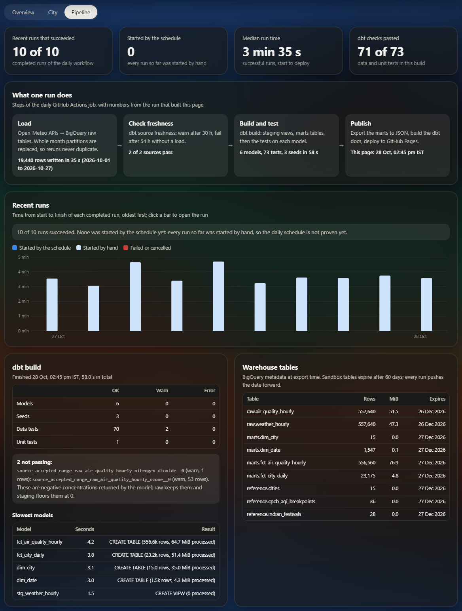

**7. On a phone.** The same page at 390 px wide: the cards stack and the charts redraw to the width.

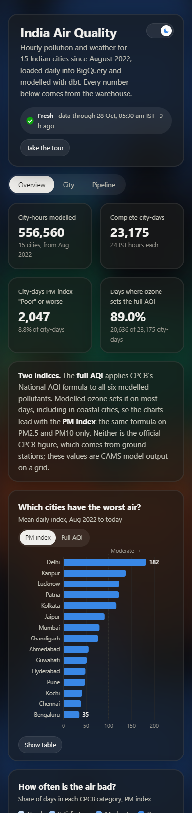

**8. dbt lineage.** Raw sources and seeds → staging views → marts, with the singular and unit tests attached
(from the published dbt docs).

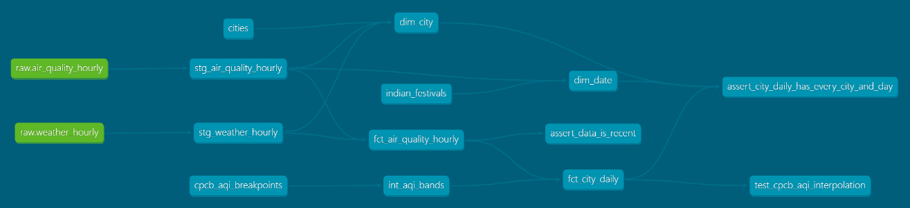

**9. The daily workflow.** One run of `daily.yml`: the pipeline job (load, freshness, `dbt build`, docs, export)
and the Pages deploy, with the reports kept as an artifact. This run was started by hand.

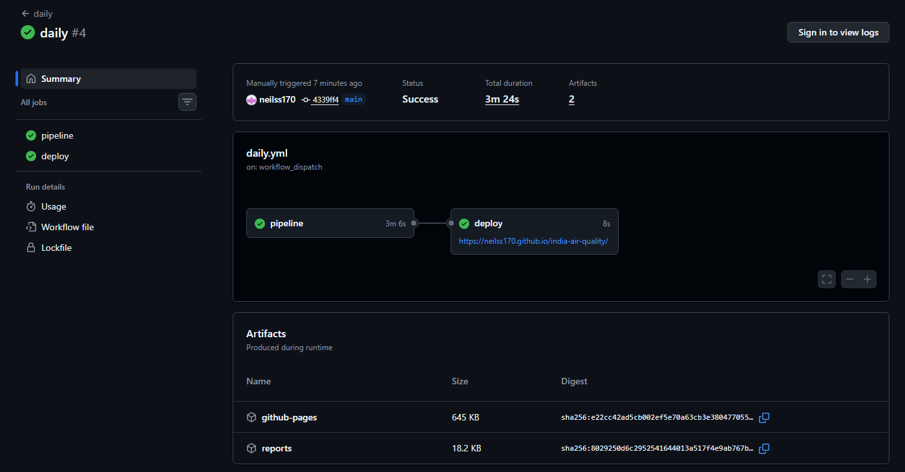

**10. Airflow.** The monthly DAG (`load_month → check_month → source_freshness → dbt_build`) after the backfills:
six runs, none failed.

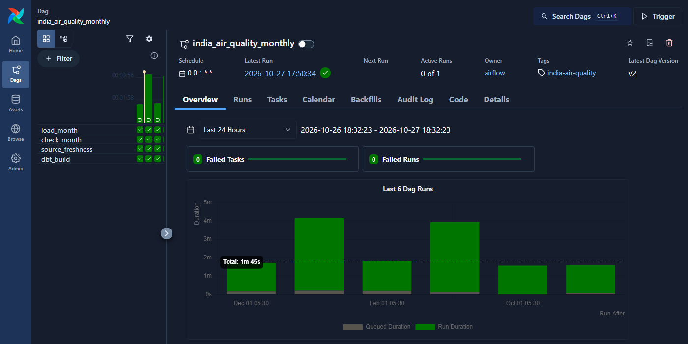

## Architecture

```
Open-Meteo APIs (CAMS air quality, ERA5 weather)
   │  loader/ (Python): one request per city, retries, UTC hours
   ▼
BigQuery raw          integer-range partitioned by month; each load replaces whole months
   │  dbt
   ├─ staging         views: typed, units in names, IST time, negative model values floored at 0
   ├─ reference       seeds: cities, CPCB AQI breakpoints, festival dates
   └─ marts           tables: dim_city, dim_date, fct_air_quality_hourly, fct_city_daily
   │  scripts/export_dashboard.py
   ▼
GitHub Pages          dashboard (vanilla JS, hand-written SVG) + dbt docs

Scheduler: GitHub Actions, daily 02:47 UTC (load → freshness → dbt build → export → deploy)
Backfills: Airflow 3 in Docker, one DAG run per month
```

Stack: Python 3.12, BigQuery (free sandbox), dbt-core 1.12 with dbt-bigquery, GitHub Actions, Airflow 3.3,
Docker. No Spark: the warehouse holds about 1.1 million raw rows and a full `dbt build` reads at most about 65 MiB
per model, so BigQuery's own engine does the transformation and a cluster would add cost without benefit.

## How it works

**Loading without DML.** The BigQuery sandbox rejects `MERGE`, `UPDATE` and `DELETE`. The raw tables are therefore
integer-range partitioned on `month` (YYYYMM), and every load job writes `table$YYYYMM` with `WRITE_TRUNCATE`, so a
re-run replaces exactly the months it covers. The daily run (`--days 10`) reloads the current month up to yesterday,
which picks up late or revised hours. Integer-range partitions also avoid the sandbox's 60-day expiry of time
partitions, and each run pushes the table expiry forward.

**Models.** Views and full-rebuild tables only (no incremental models, since those need `MERGE`). Staging converts
UTC to IST and drops 1-3 Aug 2022, before the CAMS history starts. `fct_city_daily` keeps complete IST days
(24 hours) and computes the CPCB National AQI (2014): 24-hour means for PM2.5, PM10, NO₂ and SO₂, the day's highest
8-hour mean for O₃ and CO, linear interpolation within each band, AQI = highest sub-index. Two gaps in the CPCB table
are closed explicitly: bands are made continuous (PM2.5 "Good" ends at 30 and "Satisfactory" starts at 31), and the
open-ended Severe band repeats the width of the band below it, capped at 500. Sub-indices are rounded to 6 decimals
before the AQI is rounded, because BigQuery's float `AVG` is not order-stable and values of exactly x.5 otherwise
rounded differently between runs.

**Tests.** `dbt build` runs 72 data tests and 1 unit test. Besides keys, relationships and accepted values there
are custom generic tests for value ranges, (city, hour) uniqueness and exactly 24 hours per city per day, a check that
every city has every day, source freshness, and a recency warning. The unit test runs the AQI logic on fixed inputs
with hand-computed answers (and fails when an expected value is changed). Independently,
[`scripts/marts_report.py`](scripts/marts_report.py) recomputes the AQI in pandas from the hourly data for 200 random
city-days.

**Airflow.** [`orchestration/dags/india_air_quality.py`](orchestration/dags/india_air_quality.py):
`load_month → check_month → source_freshness → dbt_build`, one run per calendar month. It uses
`CronDataIntervalTimetable`, because in Airflow 3 a plain `@monthly` gives each run a zero-length data interval.
dbt tasks share a one-slot pool so overlapping runs cannot rebuild the same tables at once. GitHub Actions stays the
scheduler because free, always-on Airflow hosting does not exist.

## Measured results

| | |
|---|---|
| Raw rows | 557,280 per table (15 cities × 37,152 hours, 1 Aug 2022 - 26 Oct 2026), 0 duplicate (city, hour) |
| Full backfill | 150 API requests, about 8 minutes ([report](reports/load_backfill_2022-08_2026-10.json)) |
| Idempotency | November 2024 loaded twice: 10,800 rows both times; after the daily reload and four Airflow backfills the totals are unchanged |
| Staging | 556,200 rows per view, 0 nulls in every measure ([report](reports/staging_latest.json)) |
| Marts | 23,160 complete city-days, 1,546 dates, 15 cities |
| `dbt build` | 80 pass, 2 warn, 0 fail |
| AQI cross-check | 200 / 200 random city-days match the pandas recomputation ([report](reports/marts_latest.json)) |
| Daily job | 3 min 14 s plus 9 s deploy; the load step reloaded October 2026 (9,360 rows per table) in 46 s |
| Airflow backfill | one month in 93 s (load 30 s, check 3 s, freshness 9 s, `dbt build` 48 s) |
| CI | pytest + `dbt parse` in 47 s |

The two warnings are real: the model returned 54 negative hourly concentrations (53 ozone, down to -7 µg/m³; 1 NO₂),
all in August-September 2022. Raw keeps them and a warn-level test counts them; staging floors them at 0.

## Findings

These are modelled values (CAMS, nearest grid cell), not ground-station readings, and the AQI is the CPCB formula
applied to them, not the official CPCB figure.

**Ozone sets the full AQI on 89% of city-days** (20,622 of 23,160; PM2.5 on 1,815, PM10 on 686). The median daily
8-hour ozone maximum is 103-154 µg/m³ in every city, including coastal Kochi and Chennai, and anything above 100 is
already "Moderate". Global chemistry models have been reported to simulate higher ozone than observed at Indian sites
([Hakim et al., 2019](https://acp.copernicus.org/articles/19/6437/2019/); not CAMS-specific). The marts therefore
also carry a PM index (`aqi_pm`, the higher of the PM2.5 and PM10 sub-indices), which the dashboard leads with:

| City | Mean full AQI | Days Poor or worse | Mean PM index | Days Poor or worse (PM) |
|---|---|---|---|---|
| Delhi | 236 | 56.9% | 182 | 36.1% |
| Kanpur | 194 | 34.1% | 137 | 22.7% |
| Lucknow | 187 | 31.7% | 122 | 17.9% |
| Patna | 200 | 41.7% | 122 | 19.9% |
| Kolkata | 183 | 39.0% | 117 | 21.7% |
| Mumbai | 184 | 41.8% | 80 | 6.3% |
| Bengaluru | 113 | 4.8% | 35 | 0.0% |

All 15 cities are in [`reports/marts_latest.json`](reports/marts_latest.json). Mumbai's high full AQI comes from
ozone: all 122 hours above 500 µg/m³ are in Mumbai (peak 930 on 13 March 2023).

- **Rain.** Mean daily PM2.5 is 53.0 µg/m³ on dry days and 18.7 on days with 30 mm or more. Within the monsoon alone
  it is 36.1 vs 18.4, so the effect is not only seasonal.
- **Diwali shows no clear spike.** Diwali-day PM2.5 was above the week before in 2 of 4 years across the 15 cities
  and in 1 of 4 in Delhi (2023: 90 the week before, 36 on Diwali). A global model driven by emission inventories is
  unlikely to capture a one-night fireworks spike; ground stations are the right source for this question.
- **Daily cycle.** PM2.5 peaks between 19:00 and 23:00 IST in 12 of 15 cities (exceptions: Pune 07:00, Jaipur 08:00,
  Mumbai 14:00). Ozone peaks around 13:00.
- **Seasons.** Kanpur, Lucknow, Patna and Kolkata have their worst three months in November-January; Delhi's are
  January, May and November. Bengaluru, Chennai and Kochi are Good or Satisfactory on the PM index on over 99% of
  days; Mumbai on 78.7%.
- **Delhi's May jump is mostly the model.** Delhi's May PM index went 104 (2023), 149 (2024), 321 (2025), 380 (2026).
  Almost all of it is coarse dust: May PM10 averaged 90, 173, 366 and 486 µg/m³, while PM2.5 only went 56, 53, 83,
  103, and Kanpur and Jaipur show the same pattern. The steps line up with two CAMS upgrades that changed the dust
  scheme: [cycle 48R1](https://confluence.ecmwf.int/spaces/COPSRV/pages/315580957/Implementation+of+IFS+cycle+48r1+for+CAMS)
  on 27 June 2023 (more and coarser dust) and
  [cycle 49R1](https://forum.ecmwf.int/t/cams-model-cy49r1-successfully-upgraded-on-12-november-2024/7622) on
  12 November 2024 (new dust source function). There was a real dust storm on 14-15 May 2025, but ground stations
  [peaked at about 338 µg/m³ PM10](https://www.theweek.in/wire-updates/national/2025/05/15/des92-delhi-ld-dust.html),
  below the model's mean of 366 for the whole month.

## Limits

- Modelled grid values, not stations (Delhi's request at 28.6139, 77.2090 is answered from the cell at 28.6, 77.2).
- The source model changes underneath the pipeline. Open-Meteo serves the CAMS version that was live at each time,
  so trends across the June 2023 and November 2024 upgrades are not like for like, especially dust (PM10) in the
  north-west. The month-by-month chart marks both upgrades.
- Updated once a day, not real-time; GitHub may start scheduled runs late.
- GitHub disables scheduled workflows in a public repository after 60 days without activity, and the sandbox expires
  tables 60 days after creation. If the schedule stops for that long, run the backfill again.
- Two Diwali dates (2022 and 2026) were not checked against a government holiday list; the seed records the source of
  each date.
- The Airflow pool has not been exercised by a real overlap of two runs; it is a safeguard.

## Run it

Needs Docker, a GCP project with BigQuery (the free sandbox is enough) and a service account with BigQuery Data
Editor and Job User. Put the key at `secrets/gcp-key.json` and copy `.env.example` to `.env`.

```bash
docker compose build app
docker compose run --rm app python scripts/check_connection.py
docker compose run --rm app python -m loader.main --start 2022-08-01   # backfill to yesterday
docker compose run --rm app dbt build
docker compose run --rm app python scripts/export_dashboard.py       # writes docs/data/dashboard.json
docker compose run --rm app python -m pytest

# Airflow (UI on localhost:8080)
docker compose --profile airflow up -d airflow
docker compose --profile airflow exec airflow airflow dags unpause india_air_quality_monthly
docker compose --profile airflow exec airflow airflow backfill create \
    --dag-id india_air_quality_monthly --from-date 2024-11-01 --to-date 2024-11-01
```

In GitHub Actions the key is the `GCP_SA_KEY` secret and the project and location are repository variables.

## Data

Air quality: [Open-Meteo Air Quality API](https://open-meteo.com/en/docs/air-quality-api) (CAMS global model, hourly
from 4 August 2022). Weather: [Open-Meteo Historical Weather API](https://open-meteo.com/en/docs/historical-weather-api)
(ERA5 reanalysis). AQI breakpoints: CPCB National Air Quality Index (2014).
